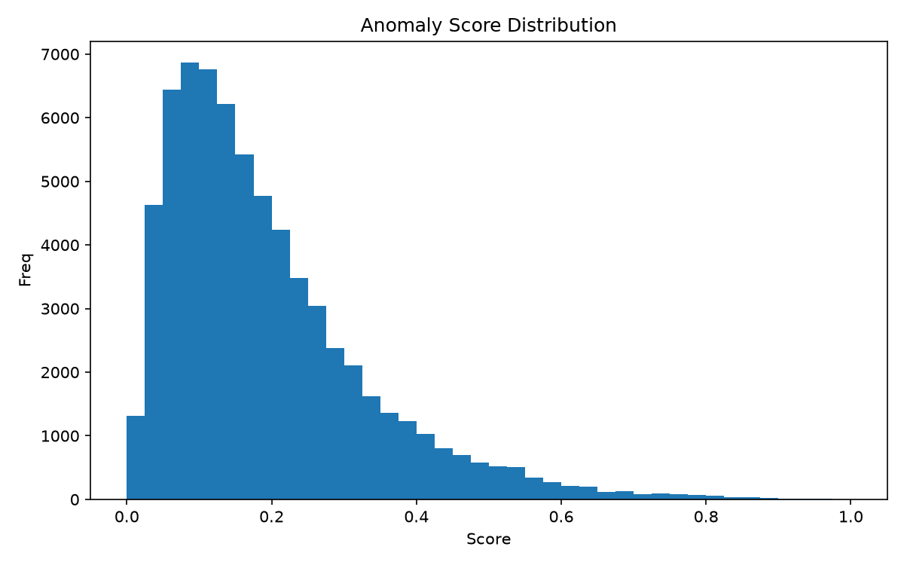
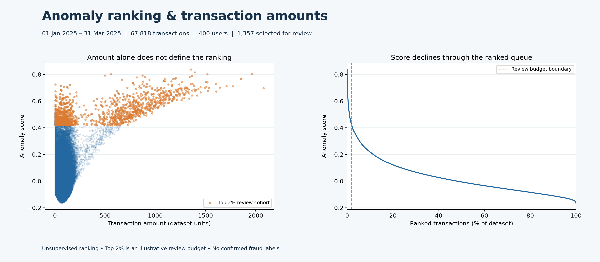
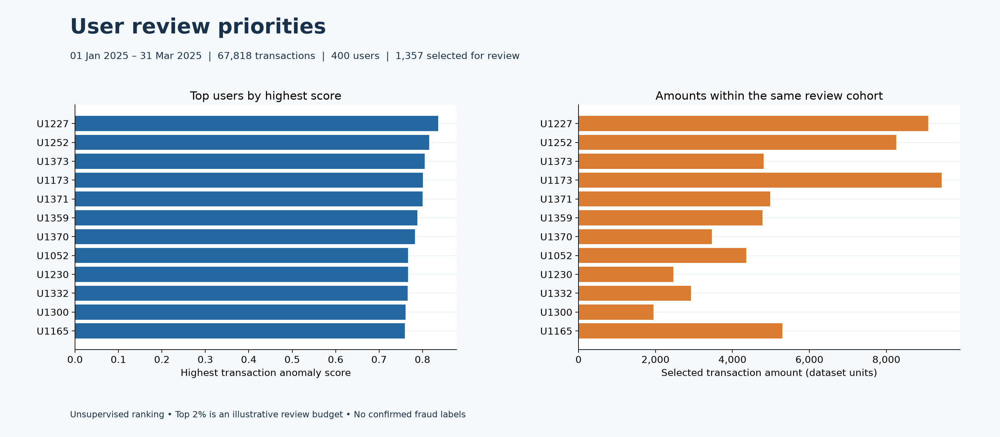
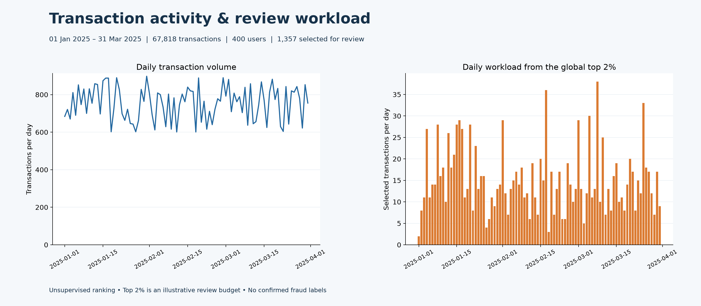

# Fraud-Detection-Model

Detect potentially fraudulent bank transactions using **SQL (SQLite)** for feature engineering and **Python** for unsupervised anomaly detection with Isolation Forest.

---

## Overview

This project demonstrates a practical fraud detection workflow where no labeled data is available.  
It integrates **SQL-based data aggregation** with **machine learning anomaly detection**, showing how data engineers and analysts can uncover unusual transaction patterns in banking or financial systems.

---

## Workflow

1. **Load transaction data into SQLite**
2. **Run SQL feature engineering**
   - Compute user-level metrics (average amount, total amount, number of transactions)
   - Compute daily activity (daily totals and transaction counts)
3. **Apply Isolation Forest** to detect anomalies based on aggregated behavioral features
4. **Generate outputs**
   - Ranked anomaly scores
   - Summary tables
   - Distribution chart

---

## Project Structure

```text
Fraud-Detection-Model/
├── screenshots/
│   ├── fraud_distribution.png
├── data/
│   └── transactions.csv
├── outputs/
│   ├── fraud_scores.csv
│   └── fraud_summary.csv
├── src/
│   ├── __init__.py
│   ├── create_db.py
│   ├── detect_fraud_unsupervised.py
│   ├── queries.sql
│   └── utils.py
├── tests/
├── .github/workflows/ci.yml
├── LICENSE
├── Makefile
├── README.md
├── pyproject.toml
├── requirements.txt
├── requirements-dev.txt
└── requirements-lock.txt
```

---

## Dataset Schema

| Column | Description |
|---------|--------------|
| tx_id | Transaction ID |
| user_id | Unique user identifier |
| date | Transaction date |
| region | User region |
| merchant | Merchant name or type |
| amount | Transaction amount |

---

## SQL Feature Engineering

Feature generation is handled by `src/queries.sql`.  
It builds temporary SQL views to calculate user statistics and daily activity.

```sql
CREATE TEMP VIEW user_stats AS
SELECT user_id, COUNT(*) AS tx_count, AVG(amount) AS avg_amount, SUM(amount) AS total_amount
FROM transactions
GROUP BY user_id;

CREATE TEMP VIEW daily_user AS
SELECT user_id, date, COUNT(*) AS daily_tx, SUM(amount) AS daily_amount
FROM transactions
GROUP BY user_id, date;

SELECT t.tx_id, t.user_id, t.date, t.region, t.merchant, t.amount,
       us.tx_count, us.avg_amount, us.total_amount,
       COALESCE(du.daily_tx, 0) AS daily_tx,
       COALESCE(du.daily_amount, 0.0) AS daily_amount
FROM transactions t
LEFT JOIN user_stats us ON t.user_id = us.user_id
LEFT JOIN daily_user du ON t.user_id = du.user_id AND t.date = du.date;
```

---

## Machine Learning

The unsupervised model uses **Isolation Forest** from scikit-learn.

- Detects outliers based on feature deviation  
- Flags top anomalies (typically 2–3% of all transactions)
- Produces a normalized `anomaly_score` between 0 and 1

---

## Visualization

### Anomaly Score Distribution


This histogram visualizes the distribution of anomaly scores across transactions.  
The right-side tail represents potentially fraudulent or irregular activities.

---

## Tools & Libraries

| Tool | Purpose |
|------|----------|
| **SQLite** | Feature engineering and querying |
| **Python** | Analysis and ML modeling |
| **pandas** | Data manipulation |
| **scikit-learn** | Isolation Forest implementation |
| **matplotlib** | Visualization |

---

## Usage

### Load Data into SQLite
```bash
python src/create_db.py --csv data/transactions.csv --db fraud.db
```

### Run Detection
```bash
python src/detect_fraud_unsupervised.py --db fraud.db --sql src/queries.sql --outdir outputs
```

---

## Outputs

| File | Description |
|------|--------------|
| `fraud_scores.csv` | Ranked transactions with anomaly scores |
| `fraud_summary.csv` | User-level fraud summary |
| `fraud_distribution.png` | Histogram of anomaly scores |

---

## Conclusion

This project showcases a complete unsupervised anomaly detection pipeline.  
It demonstrates how **SQL + Python** can work together to identify rare or irregular financial behaviors — a foundation for fraud prevention and risk analysis systems.

# Author

Adveidh Krishna

Financial Analyst

[LinkedIn](https://www.linkedin.com/in/akthotarath)


## Screenshots


## Data and project chronology

The observed transaction snapshot covers **January 1–March 31, 2025** (67,818 records). Its dates were shifted forward uniformly by 366 days, preserving the number of observations, elapsed-day spacing, leap-day separation, transaction amounts and SQL daily-user groupings. No forecast or deployment date is claimed by this retrospective anomaly-ranking pipeline.

The pipeline writes its chart to `screenshots/`, a sibling of the chosen CSV output directory. The default run produces `outputs/*.csv` and `screenshots/fraud_distribution.png`.

The project-development window is **March–August 2026**. All observed transactions precede the earliest project commit. Generated CSV artifacts retain the input transaction identifiers and monetary values.


### Additional model output reports







These reports use a global, rank-based top 2% review budget, with transaction ID breaking score ties. This is an illustrative workload selection, not confirmed fraud. User amounts include only selected transactions. Generate them after exporting scores with `python scripts/generate_visual_reports.py`. All transaction dates cover January–March 2025.
